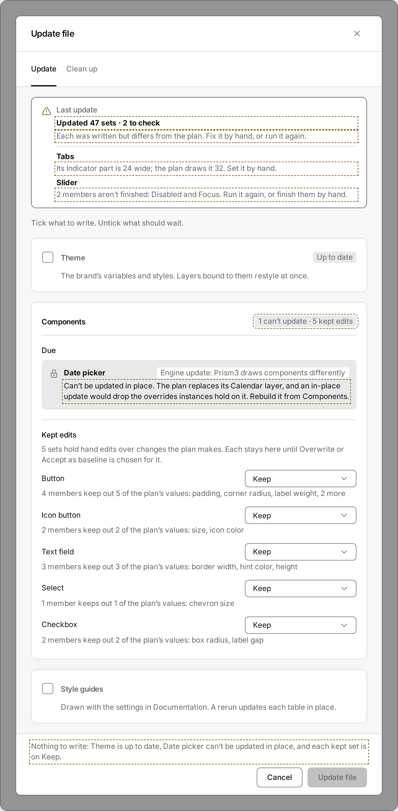
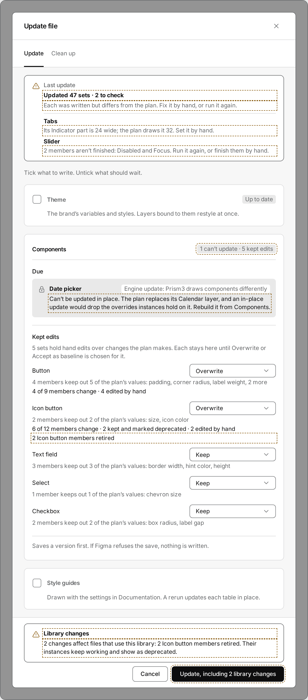
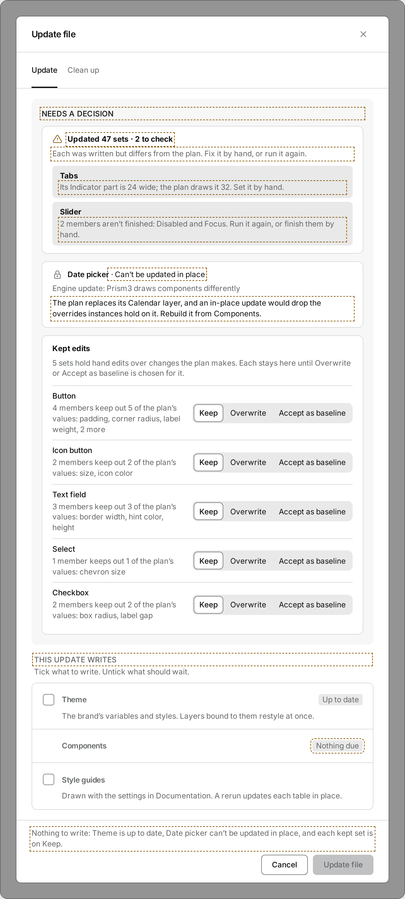
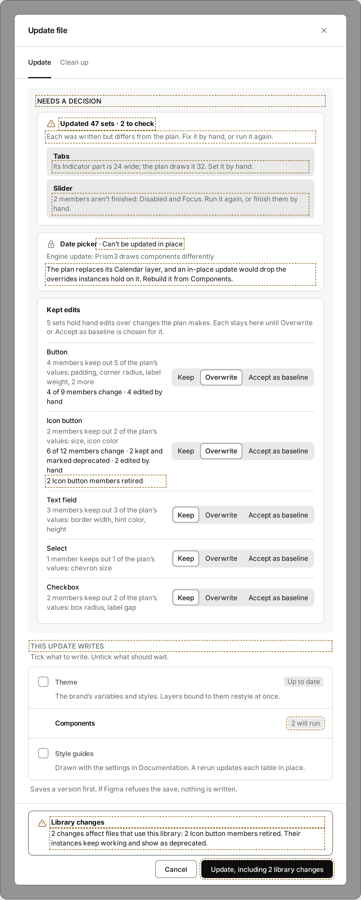
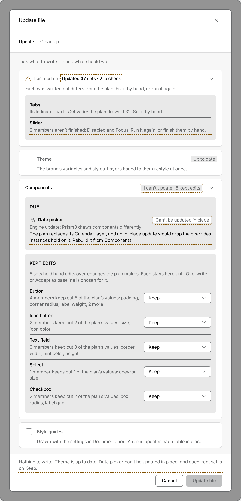
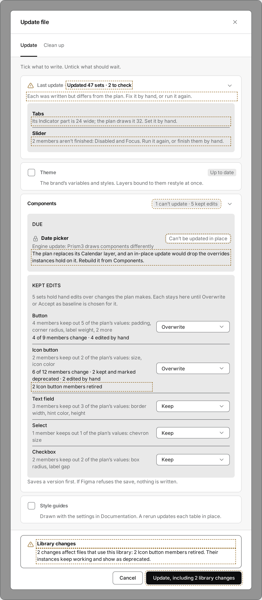

# Update file dialog: redesign directions (#3712, Q-UD1 A)

This is a design exploration. Nothing here changes the shipped dialog, and nothing gets built into it until the owner
picks a direction. These notes cover four things:

1. the audit of the dialog as it stands on `main`;
2. the Studio container language the owner asked the dialog to match;
3. three directions, each one a clickable self-contained mock;
4. the tradeoffs, and a recommendation.

| File | What it is |
|---|---|
| `direction-a.html`, `direction-b.html`, `direction-c.html` | The mocks. Open one in a browser. The toolbar switches the state, light or dark, the window width (640 or 380) and the DRAFT marks. |
| `src/` | Their source: `core.js` (the states, the strings, the model), `<key>.js` and `<key>.css` per direction, and `template.html`. |
| `build.mjs` | Builds the three pages from `src/` with the Studio's own chrome CSS. |
| `shoot.mjs` | Renders every state to `shots/` with the pre-installed Playwright, at deviceScaleFactor 2. |

```sh
node docs/superpowers/update-dialog-redesign/build.mjs && node docs/superpowers/update-dialog-redesign/shoot.mjs
```

**The chrome is the product's.** `build.mjs` calls `buildChromeCss()` from `apps/studio/chrome/esbuild-plugin.mjs`,
the same function the Studio and plugin builds call. That gives every `--p3-*` variable in light and dark, the
embedded faces and all of `src/chrome.css`. The icons are the vendored Tabler paths (`src/shell/icons/tabler.ts`). Each
mock draws with the dialog's real classes wherever the dialog already has one (`.p3-bardlg`, `.p3-tabs`, `.p3-check`,
`.p3-sg-tag`, `.p3-select`, `.p3-seg`, `.p3-op-prog`, `.p3-lsec`, `.p3-sg-warn`, `.p3-card-title`). A direction's own
CSS reads chrome tokens only. `build.mjs` fails, by file and value, when a direction's CSS carries a raw color, length,
duration or shadow (`scanRaw`, the mockups' scan in `chrome/tokens.mjs`), or reads a `--p3-*` variable the chrome
doesn't define.

**Strings.** Every existing string is copied word for word from `UPDATE_COPY` (`apps/studio/src/state/update-file.ts`)
and `STRIP_COPY` (`apps/studio/src/state/status-strip.ts`). The #3711 strings (Q-UF1–3) are used as the issue words
them. Strings these mocks add are listed in `core.js` (`D`), and every one is DRAFT. On screen, every #3711 or new string
has a dashed outline while DRAFT marks are on.

**The demo file.** It uses a neutral demo brand and the engine's generic set names. In the owner's 2026-11-12 case:

- one blocked set (Date picker);
- five Kept-edit sets (Button, Icon button, Text field, Select, Checkbox);
- Theme up to date;
- a last run that ended "Updated 47 sets · 2 to check" (Tabs, Slider).

The two library changes (#3711 Q-UF2) appear once Overwrite is chosen on Icon button, whose update retires two
members. "…Overwrite on 2" is that state, with Overwrite chosen on Button and Icon button. As opened, every kept set is
on Keep, so nothing runs and the foot is disabled with its reason.

## 1 · Audit: what the dialog can show today

Paths are under `apps/studio/src/`. The view is `shell/update-file.ts`; the words and rules are `state/update-file.ts`
(`UPDATE_COPY` at line 307); the styles are `chrome.css` 2040–2096.

### States

| State | Where | Shows |
|---|---|---|
| Reading the file | `shell/update-file.ts:247` | "Checking the file…" alone, foot Cancel |
| Read failed | `:248` | `readError` in danger ink, foot Cancel |
| Checklist (set-up file) | `:249–539` | `lead`, then the items below |
| Checklist (fresh file) | `:253,257,492` | `leadFresh`, Set up file ticked, Theme ticked, To add with Add all, action "Set up and update" |
| Last run stopped | `:256` | `stopped(step, headline)` as one danger line at the top |
| Check in progress | `:504–516` | foot: the bar plus "Reading this file…" or "Checked n of N sets"; each due row "Checking…" or its line |
| Run out | `:224–245` | "Step n of N · step", each update set Due → Updating → Updated, foot Close + Stop |
| Clean up tab | `:542–586` | `cleanLead`, then "Checking for stale items…", a prune summary + Delete n items, retired tables + Remove n tables, usage panels + Remove n panels, or "Nothing stale in this file." |
| Brand didn't restore | `:493–494`, `:550` | action disabled, reason only in its `title` tooltip |

### Items and controls (Update tab, in order)

1. **Set up file** (`:259`). A tick, its title, and `setupSub`, or on a set-up file `setupMissing(names)`.
2. **Theme** (`:264–271`). A tick, "Theme", the tag "Up to date" when it matches, and `themeSub`. Toggling it checks the file again.
3. **Components** (`:304–481`), a section title with up to four subtitled groups:
   - **To add** (`:308–349`): the subtitle and Remove all (from 2 rows up), `toAddSub`, rows of name + "↳ Page" + ×, then "Also adds: …". On a fresh empty queue: `queueFresh` + Add all n.
   - **Due** (`:350–402`): the subtitle, `dueSub`, each set a tick + name + `dueWhy` tag. Under each, the check's line: `checked()` "n of m members change · …", "Checking…", or empty. Then the `breaks` line, `checkError`, and "n sets not checked yet" + Check n sets.
   - **Usage panels** (`:404–436`): the subtitle, the tick "Draw n usage panels", `panelsAll` or `panelsSome`, the names, and past six "Show the n sets".
   - **Kept edits** (`:439–478`): the subtitle, `keptSub`, and each set a name + select (Keep / Overwrite / Accept as baseline), `keptLine` and, when not Keep, its check line.
   - `saves` (`:480`), the section's last line.
4. **Style guides** (`:482`). A tick, its title, and `guidesSub`.
5. **Foot** (`:503–538`): [progress] [Hand edits + select] Cancel, then Update file or Set up and update. The `handHint` line drops into the body's end (`:537`).

**Blocked sets.** A blocked set has no state of its own. It is a Due row, ticked like the rest, whose line reads "Can't
be updated in place yet; the agent's update check says why" (`state/update-file.ts:354`). Its tick does nothing:
`updateDefsOf` drops it.

**Disabled foot.** Update file is disabled for one of three reasons: no steps, `off`, or waiting on the check
(`:493`). Only `off` gives a reason, and only in a tooltip. Nothing on screen says why the button is off.

### Hierarchy, spacing and alignment problems

| # | Problem | Where |
|---|---|---|
| H1 | Every level is the same weight. The item titles, the Components title and its subtitles are all 14px, and only `fw-emphasis` vs bold tells them apart. Due, Kept edits and To add read at the item level, so the steps, the due sets, the kept edits and the banner compete, as the owner said. | `chrome.css:2047,2058`; `<b>` at `:215,305` |
| H2 | The last-run line is a bare danger paragraph above the lead, with no container and no glyph. Q-UF3's warning, a run that wrote everything, would read as a failure in red. | `:256` |
| H3 | The library-consumer change (`breaks`) is a gray sub-line under its set, at the same weight as "4 of 9 members change". That is how the owner missed it on 2026-11-12 (#3711). | `:381` |
| H4 | A blocked set looks like a due set: same tick, same row, same gray line. Its reason points elsewhere. | `:357–381`, `state/update-file.ts:354` |
| H5 | The disabled action gives no reason on screen. | `:493–494` |
| H6 | The hand-edits hint is the body's last line, far from the select in the foot it explains. | `:537` vs `:517–535` |
| S1 | Items are split by hairline rules (`border-bottom: line-1`). This is the pattern the owner asked to replace with containers and gray surfaces. | `chrome.css:2044–2045` |
| S2 | Indents are cumulative paddings that don't share a grid: a sub-line is in space-400 (32px), the set lists space-300 (24px), the Components title space-100 (8px), the subtitles space-400, the add rows space-100 on top of the list's space-300, and Add all / Show / handrow / saves space-300. Five different left edges in one column. | `chrome.css:2046–2048,2058,2064,2067,2070,2081,2094–2095` |
| S3 | The sub-line's 32px indent (space-400) doesn't land on the tick label's text. The check pads space-100 inside its hairline, so the label starts at hairline + space-100 + box + gap + space-025 = 39px, and the line under it sits 7px left of the text it describes (measured in the mocks' render). | `chrome.css:2046`, `.p3-check` 1126 |
| S4 | The gaps mix three scales: body gap space-100, item padding space-100, group gap space-050 with padding-top space-100, row gap space-025. None of them is the settings rhythm (`--p3-rhythm-*`, #3337) the rest of Studio uses. | `chrome.css:2042,2044,2048,2057` |
| S5 | A Due row's tag and name share one wrapping line, so a long `dueWhy` tag ("Engine update: Prism3 draws components differently") wraps under the name, and rows of different heights sit in one list. | `chrome.css:2052–2054` |
| A1 | The Kept-edit select sits right after the name (`.p3-upd-handsel`, gap space-100), not in a column, so the five selects don't line up. | `:467–469`, `chrome.css:2085` |
| A2 | The foot puts progress, the hand-edits select, Cancel and the action on one wrapping row. At 380 the select takes its own row and the progress wraps unpredictably. | `:504–535`, `chrome.css:2088,2091` |

## 2 · The Studio container language

These are the patterns the owner named, and the exact chrome pieces behind them:

| Pattern | Class (`apps/studio/src/chrome.css`) | Tokens |
|---|---|---|
| The gray panel the cards sit on | `.p3-levers` (426), `.p3-levers-body` (942) | `--p3-levers-bg`; padding space-300; card gap `--p3-rhythm-section` (space-200) |
| A section card on the gray (Color's sections) | `.p3-lsec` (947) | `--p3-bg-page`, hairline `--p3-line-1`, `--p3-radius-xl`, padding space-300, row gap `--p3-rhythm-row` |
| Section title (L1) / group heading (L2) / field label (L3) | `.p3-lsec-title` (973), `.p3-lever-name` (985), `.p3-icol-title` (1469) | fs-16 / fw-strong; fs-14 / fw-strong / ls-snugger; fs-14 / fw-emphasis |
| Groups inside a card (Interactive's state groups) | `.p3-icol` (1465), `.p3-icard` (1478) | hairline top `--p3-line-1`, padding-top space-200, group gap `--p3-rhythm-group` |
| A card holding a family's settings on gray (Button options) | `.p3-icol.p3-cp-optsec` (1210) | `--p3-levers-bg`, edge `--p3-edge`, radius-xl, padding space-300 |
| Palettes' board, its small-capital title | `.p3-card` (498), `.p3-card-title` (505), `.p3-board-body` (1245), `.p3-pal + .p3-pal` (1247) | fs-12 / fw-emphasis / ls-open / uppercase; palettes split by a hairline at space-300 |
| An inset on the fill gray (tips, tracks) | `.p3-tip` (1023) | `--p3-fill-1`, radius-lg, padding space-150 space-200 |
| A boxed warning | `.p3-sg-note.p3-sg-warn` (1737–1743) | `--p3-bg-page`, hairline `--p3-line-2`, radius-xl, glyph `--p3-warn-icon` |
| Status chip | `.p3-sg-tag` (1796) | `--p3-fill-1`, `--p3-text-2`, radius-md, fs-12 |
| Segmented choice | `.p3-seg`, `.p3-seg-tab` (317–329) | track `--p3-bar-bg`; selected `--p3-bg-page` + `--p3-edge-bar` |

**Contrast pairs these mocks stay inside** (`chrome/spec.mjs` PAIRS): `text` and `text-2` on `bg-page`,
`levers-bg` and `fill-1`; `warn-icon` on `bg-page` and `fill-1`; `icon-2` on `bg-page`, `fill-1` and `levers-bg`. No
mock puts a status glyph straight on `levers-bg`, where `warn-icon` has no declared pair.

## 3 · The directions

Every direction shows the same states:

- the owner's 2026-11-12 run, as opened (disabled foot) and with Overwrite on 2 (library changes and the counted label);
- all up to date;
- a fresh file with To add;
- the check in progress.

Each state renders in light and dark, plus the owner's case at 380. Every direction keeps the run order, the strings and
the controls of today's dialog, and adds the same four behaviors:

- the library changes callout in the foot, over the button it qualifies (Q-UF2);
- the disabled action's reason, on screen, at the foot's start;
- a blocked set drawn as its own row, with a lock and its reason, no tick;
- the last run's warning in a container with the warning glyph, not in danger ink (Q-UF3).

### A · Cards on gray

The body takes the levers gray. Each step (Set up file, Theme, Components, Style guides) is a `.p3-lsec` white card on
it, in run order. Inside Components, To add, Due and Kept edits are groups split by a hairline at the group rhythm,
as Interactive's state groups are. Kept edits put the select in a column at each row's end. The last run is the Style
guide's boxed warning at the top.




- **For.** It is the most literal match to the Color tab: same card, same gray, same group split. It keeps the
  composition the owner has already approved (R6: Components with its subtitles), so the change is visual, not
  structural. It fixes S1–S5 and A1 with one indent (the tick label's) and the settings rhythm.
- **Against.** The owner's case is still long: everything is open, and the decisions (five selects, a blocked set) sit
  in the middle of the scroll, below Theme. The run order puts the last run's warning at the top and the library
  callout at the bottom, with the decisions between them.

### B · Decisions first

What needs a person comes first. A gray well titled "Needs a decision" (DRAFT) holds white cards: the last run's sets
to check, each blocked set, and Kept edits. Each kept set shows its three choices at once as a segmented control. Under
the well, one white list card, "This update writes" (DRAFT), has one row per step in run order, each with its tick and
a status chip. Components' row carries an inset of its sets when it adds or updates any.




- **For.** It answers the owner's complaint most directly. The things that compete today are sorted by whether they
  need you, and what runs reads as a short checklist. The segmented control makes Keep / Overwrite / Accept visible
  without opening a select, and five of them line up.
- **Against.** It is a composition change (an owner decision of its own). Kept edits leave Components, so a set can
  appear in two places: as a decision above, and in the count of what runs below. The segments are wide: at 380 each
  takes its own row under the set (see `b-chosen-light-380.png`), and three labels per set times five sets adds a lot of
  text. It adds two DRAFT section titles.

### C · Folded step cards

As in A, each step is a white card on the gray, but folded to one header row: its tick, its name, a status chip, and a
chevron, as Components' families fold. Only a card that needs a person opens by itself: the last run with sets to
check, Components with a blocked or kept set, or To add on a fresh file. Inside an open card, each group is an inset on
`fill-1` with Palettes' small-capital title, its rows split by hairlines, so a set reads as a table row with its
control at the end.




- **For.** It is the most compact when little needs a person: Theme and Style guides are one line each, and the chips
  ("Up to date", "1 can't update · 5 kept edits") say what is folded. The fill-1 insets read as the Palettes and
  tracks language, and give the most separation between groups without adding rules.
- **Against.** Folding hides state: a folded card's line (Theme's "Layers bound to them restyle at once") isn't
  visible until it's opened, and a reviewer has one more click to see what a step writes. It adds a disclosure per
  card, and the per-card chips are new strings. In the owner's case Components opens anyway, so the long part isn't
  shorter than in A.

### Every shot

`shots/<direction>-<state>-<mode>[-380].png`. The states are `owner`, `chosen` (Overwrite on 2), `clean`, `fresh` and
`checking`. Each shot is drawn full length, with the window grown to the dialog so every row shows. The real window
scrolls the body between the head and the foot, as each mock does when opened without `full=1` in its URL.

## 4 · Recommendation

**A, Cards on gray.** It matches the owner's direction most literally: the same `.p3-lsec` cards on the levers gray, and
the same hairline group split as the Color tab. It keeps every composition decision already made (R6, R7, Q39), so the
building PR is a restyle plus the four shared behaviors above, with no new composition to approve. B's ordering is the
stronger fix for "everything competes", but it is a second owner decision on top of the visual one, and it splits Kept
edits from Components. C's fold can be added to A later, per card, if the owner finds A too long in use.

OWNER DECISION: pick a direction (A, B or C), and sign off the DRAFT strings in `src/core.js` (`U` from #3711, `D` new).
